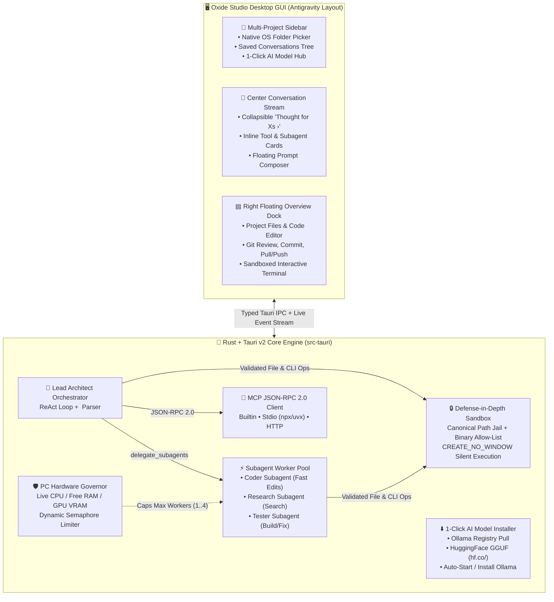
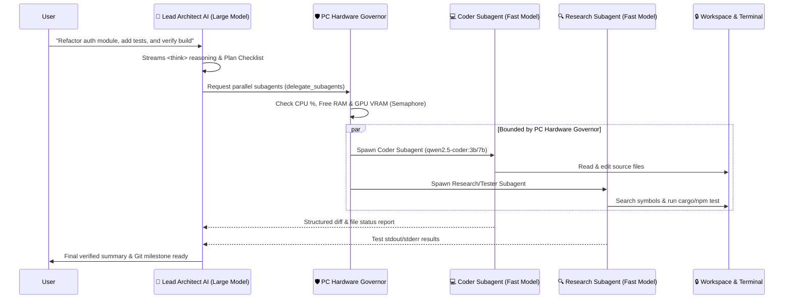

<div align="center">


# OXIDE STUDIO `[Fe₂O₃]`

### **Local-First Autonomous AI Coding Agent & Multi-Project Desktop IDE**
*Built with **Rust**, **Tauri v2**, and **React 18 / TypeScript** — Styled after **Google Antigravity***

[](https://github.com/Hanzkii/Oxide/releases/latest)
[](https://hanzkii.github.io/Oxide/)
[](https://hanzkii.github.io/Oxide/#models)
[](https://hanzkii.github.io/Oxide/#mcp)
[](./LICENSE)

---

**[⬇ Download Latest Windows `.exe` Release](https://github.com/Hanzkii/Oxide/releases/latest)** · **[🌐 Interactive Documentation & UI Showcase](https://hanzkii.github.io/Oxide/)** · **[🔌 Model Context Protocol (MCP) Guide](#6-model-context-protocol-mcp-hub)**

</div>

---

## ⚡ What is Oxide Studio?

**Oxide Studio** is a standalone, local-first autonomous software engineering desktop application inspired by **Google Antigravity**. It lets you open multiple project folders on your PC, save persistent AI engineering conversations per project, and orchestrate a **Lead Architect AI** alongside parallel **Fast Subagents**—completely offline via **Ollama** & **HuggingFace GGUF** models (including **Coding**, **Uncensored / Abliterated**, and **DeepSeek-R1 Reasoning** models) or with hybrid cloud fallback (**Claude 3.5 Sonnet** / **GPT-4o**).

Every action taken by the AI—its internal `<think>` chain-of-thought reasoning, subagent delegation, file edits, terminal commands, and Git commits—streams live in a clean, matte-carbon interface without ever popping up sketchy background terminal windows.

---

## 🧭 System Architecture Overview



---

## 🚀 1. How to Install & Open Oxide Studio

### Option A: Standalone Windows Installer or Portable `.exe` *(Recommended)*
Every push to `main` builds a native Windows NSIS installer and portable executable on GitHub Actions:
1. Go to **[GitHub Releases](https://github.com/Hanzkii/Oxide/releases/latest)**.
2. Download **`Oxide_0.1.0_x64-setup.exe`** (fast NSIS installer) or **`Oxide-Portable.exe`** (single-file portable executable).
3. Launch **Oxide Studio**.
4. Whenever new features are pushed to GitHub, click the **`↻ Update`** button in the bottom-left of the sidebar to download and install the latest release in one click.

### Option B: Local Repository Clone (`start-oxide.bat`)
```powershell
git clone https://github.com/Hanzkii/Oxide.git
cd Oxide
.\start-oxide.bat
```
- If a compiled binary is present, `start-oxide.bat` launches it directly.
- Otherwise, it starts the local Vite + Node system bridge and opens Oxide Studio in a dedicated app window (`--app=http://localhost:1420`) with full file, terminal, Git, hardware detection, and Ollama/HuggingFace support.

---

## 🖥️ 2. Antigravity-Inspired Workspace & Multi-Project Management

Oxide Studio is designed around a three-zone layout modeled after **Google Antigravity**:

| Workspace Zone | Capabilities |
| :--- | :--- |
| **Left Sidebar (`Projects & Conversations`)** | • **`+ New Conversation`** button starts a fresh agent thread in your active project.<br>• **Native Windows Folder Picker (`📁+` / `+ Folder`)**: Opens the native OS folder dialog (`FolderBrowserDialog`) so you can add or switch project directories without typing paths.<br>• **Multi-Project Tree**: Group multiple codebases in the sidebar and click any saved conversation to restore its full history, reasoning traces, and tool steps.<br>• **Automatic Disk Persistence**: Saved automatically to `%LOCALAPPDATA%/OxideStudio/studio_sessions.json`. |
| **Center Stream (`Thought & Action Trace`)** | • **Collapsible `Thought for Xs ›` Blocks**: Click to expand or collapse the AI's raw `<think>...</think>` chain-of-thought and numbered execution plan.<br>• **Inline Tool & Subagent Steps**: File reads/edits (`📄`), terminal executions (`>_`), and live subagent status badges appear inline between thoughts and answers.<br>• **Floating Bottom Composer**: Quick model switcher, `⬇ + Install AI` launcher, and `⚡ Turbo` subagent concurrency indicator. |
| **Right Dock (`Floating Overview Card`)** | • **Overview Card**: Shows current Git branch, changed file count, total workspace files, and terminal logs at a glance.<br>• **Expandable Drawers**: Click to expand the **Project File Explorer**, **Built-in Code Editor** (with 1-click Save & New File), **Git Review & Sync** (`Commit`, `Pull`, `Push`), or **Interactive Sandboxed Terminal**. |

---

## ⬇️ 3. 1-Click AI Model Hub (Ollama + HuggingFace GGUF + PC Spec Matcher)

Click **`⬇ AI Model Hub (1-Click)`** in the sidebar (or **`⬇ + Install AI`** in the prompt bar) to open the built-in AI Model Store.

### Automatic PC Hardware Compatibility Scoring
Oxide Studio inspects your PC's **Total RAM**, **Free RAM**, **CPU cores**, and **GPU VRAM** (`nvidia-smi` / WMI) and tags every model in the store—including live HuggingFace search results—with a real-time hardware verdict:
- 🟢 **`⚡ Runs Fast on GPU`** — Model fits inside your dedicated GPU VRAM for maximum token/s speed.
- 🔵 **`✓ Compatible with Your PC`** — Fits comfortably within your system RAM.
- 🟡 **`⚠ Tight RAM Fit (Slower)`** — Close to your total RAM ceiling; layers will offload to system memory.
- 🔴 **`⛔ Too Heavy (Needs X GB RAM)`** — Exceeds your PC's hardware capacity (can be hidden automatically with the **`✅ Fits My PC Only`** toggle).

### Smart Filters: Coding, Uncensored / Abliterated, Reasoning & Fast Subagents
Filter models by specialty or search **HuggingFace Hub Live** (`https://huggingface.co/api/models?filter=gguf`) to 1-click pull any GGUF repository directly via `hf.co/<owner>/<repo>`:

| Model Name | Source / Install ID | Size / RAM Req | Specialties | Best Role |
| :--- | :--- | :---: | :--- | :--- |
| **Qwen 2.5 Coder 7B Abliterated** | `hf.co/bartowski/Qwen2.5-Coder-7B-Instruct-abliterated-GGUF` | 4.7 GB / 8 GB | `💻 Coding` `🔓 Uncensored` | Lead or Subagent for unrestricted coding & reverse engineering |
| **Qwen 2.5 Coder 14B Abliterated** | `hf.co/bartowski/Qwen2.5-Coder-14B-Instruct-abliterated-GGUF` | 9.0 GB / 16 GB | `💻 Coding` `🔓 Uncensored` | High-precision Uncensored Lead Architect |
| **DeepSeek-R1 7B Abliterated** | `hf.co/huihui-ai/DeepSeek-R1-Distill-Qwen-7B-abliterated-GGUF` | 4.7 GB / 8 GB | `💻 Coding` `🔓 Uncensored` `🧠 Reasoning` | Unfiltered chain-of-thought `<think>` reasoning + code |
| **DeepSeek-R1 14B Abliterated** | `hf.co/huihui-ai/DeepSeek-R1-Distill-Qwen-14B-abliterated-GGUF` | 9.0 GB / 16 GB | `💻 Coding` `🔓 Uncensored` `🧠 Reasoning` | Heavyweight unfiltered reasoning architect |
| **Qwen 2.5 Coder (1.5B / 3B)** | `qwen2.5-coder:1.5b` / `qwen2.5-coder:3b` | 1–2 GB / 4–6 GB | `💻 Coding` `⚡ Fast Subagent` | Ultra-fast parallel Subagent workers on any PC |
| **Qwen 2.5 Coder (7B / 14B / 32B)** | `qwen2.5-coder:7b` / `14b` / `32b` | 4.7–19.5 GB | `💻 Coding` | Standard autonomous coding & repository engineering |
| **Dolphin 2.9 Llama-3 8B** | `dolphin-llama3:8b` | 4.7 GB / 8 GB | `💻 Coding` `🔓 Uncensored` | Unfiltered instruction-following & tool use |
| **Dolphin 2.8 Mistral 7B** | `dolphin-mistral:7b` | 4.1 GB / 8 GB | `💻 Coding` `🔓 Uncensored` | Zero alignment refusals, fast agentic execution |
| **Nous Hermes 3 Llama-3.1 8B** | `hermes3:8b` | 4.7 GB / 8 GB | `💻 Coding` `🔓 Uncensored` | Steerable agent model with native JSON function calling |
| **DeepSeek-R1 (1.5B / 7B / 14B)** | `deepseek-r1:1.5b` / `7b` / `14b` | 1.1–9.0 GB | `💻 Coding` `🧠 Reasoning` | Deep `<think>` architectural planning & debugging |

> **Don't have Ollama installed yet?** Click **`⚡ 1-Click Start / Install Ollama`** inside the Model Hub to automatically install Ollama via Winget and start the local inference server in the background.

---

## 🤖 4. Hierarchical Lead Architect + Subagents & PC Hardware Governor

Instead of running one slow model for every tiny file lookup, Oxide Studio implements a **two-tier multi-agent hierarchy**:



### How the PC Hardware Governor Protects Your Machine (`src-tauri/src/hardware.rs`)
- **Workstation Tier (`≥30 GB RAM` + `≥12 GB VRAM` or `≥12 Cores`)**: Allows up to **3–4 concurrent subagents** alongside a `14B–32B` Lead Architect.
- **Balanced Desktop Tier (`≥15 GB RAM` + `≥5.5 GB Free RAM`)**: Allows up to **2 concurrent subagents** (`1.5B–7B`) alongside a `7B–14B` Lead Architect.
- **Compact / Memory-Saver Tier (`<15 GB RAM`)**: Runs subagents **1 at a time** sequentially so your system never swaps to disk.
- **Automatic High-Load Throttling**: If live RAM usage exceeds **85%** or CPU usage exceeds **88%**, the governor automatically throttles active workers down to `1`.

---

## 🔌 5. Model Context Protocol (MCP) Hub

Oxide Studio includes a native **JSON-RPC 2.0 MCP Client & Registry** (`src-tauri/src/mcp.rs`):
- **Supported Transports**:
  - `builtin`: Built-in `oxide-memory` knowledge graph (`store_memory`, `recall_memories`) that works with zero external dependencies.
  - `stdio`: Spawns local MCP servers (`npx`, `uvx`, `node`, `python`) silently in the background (`CREATE_NO_WINDOW`).
  - `http`: Connects to remote JSON-RPC 2.0 MCP endpoints.
- **1-Click Tool Discovery**: Open **`🔌 Customizations (MCP)`** in the sidebar, click **`Discover Tools`** on any server to handshake (`initialize` → `tools/list`), and the discovered tools are automatically injected into the Lead Architect's system prompt (`call_mcp_tool`).

---

## 🔒 6. Defense-in-Depth Security & Silent Windows Execution

1. **Canonical Path Sandbox (`src-tauri/src/security/sandbox.rs`)**:
   - Every file read, write, move, delete, and terminal working directory is canonicalized and verified to reside strictly inside your active project folder, blocking `../` traversal and symlink escapes.
2. **Allow-Listed Terminal & Self-Correction (`src-tauri/src/orchestrator/terminal.rs`)**:
   - Commands execute without shell-interpolation injection, scrub cloud API keys from child environments, cap output buffers, and automatically feed non-zero exit codes + `stderr` back to the AI for autonomous self-repair.
3. **Zero Pop-up Console Windows (`CREATE_NO_WINDOW`)**:
   - Every background process on Windows (`git`, `ollama`, `nvidia-smi`, `powershell`, `npx`, and the self-updater) executes with the Win32 `CREATE_NO_WINDOW` (`0x08000000`) flag so black terminal windows never flash on your screen.

---

## 🛠️ 7. Building from Source

### Prerequisites
- **Node.js 20+** and **npm**
- **Rust stable toolchain** (`rustup`, `cargo`) + Windows WebView2 (pre-installed on Windows 10/11)

```powershell
# Install frontend dependencies
npm install

# Run in development mode (Vite + local bridge)
npm run dev

# Build production frontend bundle
npm run build

# Build native Windows NSIS Installer & Portable .exe
npm run desktop:build
```

---

## 📄 License

Distributed under the **MIT License**. See [`LICENSE`](./LICENSE) for full details.
